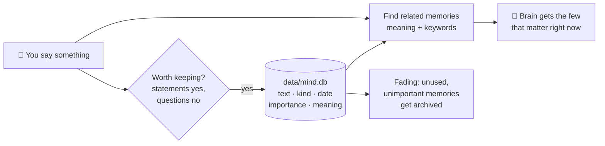

<p align="center">
  
</p>

<p align="center">
       
</p>














## Setup (Windows 10/11)

1. **Install Ollama** from https://ollama.com/download, then download Nova's brain:
   ```bash
   ollama pull qwen2.5:7b
   ```
   On a low-end laptop, use `qwen2.5:3b` and change `model` in `settings.toml`.
   For Nova's smart memory search (small, about 270 MB), also run:
   ```bash
   ollama pull nomic-embed-text
   ```
   Without it, Nova still remembers and searches by keywords.
2. **Install Node.js** (LTS) from https://nodejs.org. Nova uses it for her see-through window. The first start sets it up automatically (about a minute).
3. **Install Nova** (Python 3.11 to 3.14. Not 3.15 yet: many packages don't support it):
   ```bash
   git clone https://github.com/HemashreeVI/nova.git Nova
   cd Nova
   python -m venv venv
   venv\Scripts\activate
   pip install -r requirements.txt
   ```
4. **Edit `settings.toml`**: your name, city, voice, the pet's name, and companion options.
5. **Run**:
   ```bash
   start_nova.bat                 # double-click: picks the right Python for you
   python main.py                 # 3D Nova on your desktop
   python main.py --autostart on  # start Nova every time you log in
   python main.py --no-voice      # typing only
   python main.py --2d            # lightweight 2D body
   python main.py --terminal      # chat in the terminal
   ```
   The first run downloads the speech-recognition model (~150 MB).


## Optional: WhatsApp and Gmail

- **WhatsApp:** run `pip install pywhatkit`, copy `data/contacts.example.json` to `data/contacts.json`, and fill in the numbers. You need to be logged in to WhatsApp Web.
- **Gmail:** run `pip install google-api-python-client google-auth-oauthlib`. Create an OAuth client (Desktop app) in Google Cloud Console with the Gmail API enabled, and save it as `data/credentials.json`.

Everything in `data/` (memory, mood diary, activity log, contacts, tokens) stays private and is git-ignored.


## Teach Nova a new skill

Drop a file into `nova/skills/`. It's picked up automatically:

```python
from nova.tools import tool

@tool("Flip a coin.")
def flip_coin() -> str:
    import random
    return random.choice(["Heads!", "Tails!"])
```

Use `@tool(..., dangerous=True)` for anything risky. Nova will then ask before running it.


## How Nova's memory works



- **What's saved:** facts (*"I study CSE at VIT"*), likes (*"I love dosa"*), goals (*"I want to learn ML"*), and deadlines with real dates (*"CSE2004 assignment due tomorrow"* is saved with the actual date, so "tomorrow" never goes stale). Course codes become tags.
- **What's skipped:** questions, commands and small talk.
- **Repeats** strengthen a memory instead of creating a copy.
- **Fading:** each memory has a strength from its importance, how often it comes up, and how long since it was last used. Pinned memories and upcoming dates stay strong; passed dates fade within about a week. Faded memories are archived, never silently deleted.
- **Settings:** the `[memory]` section in `settings.toml`.


## Running the tests

```bash
pip install pytest
python -m pytest tests
```


## Project structure

```
main.py              start here
settings.toml        your settings
nova/
  app.py             wires everything together
  brain.py           local LLM + personality + tool use
  emotion.py         reads your mood, decides how Nova reacts
  voice_tone.py      mood from how you sound (learns your normal voice)
  listener.py        mic, "Hey Nova", speech-to-text
  speaker.py         neural voice styled by mood (+ offline backup)
  companion.py       welcome/goodbye, check-ins, breaks, activity log
  presence.py        lid open/close, lock/unlock, sleep/wake, active app (Windows)
  body_electron.py   the see-through always-on-top 3D window (Electron, in shell/)
  body3d.py          fallback 3D window (pywebview)
  body/              three.js: Nova's 3D body, eyes (eyes.js) and Pip
  buddy.py           lightweight 2D body (fallback)
  memory.py          chat history, simple facts and mood diary
  mind/              long-term memory engine: search by meaning, fading, deadlines (data/mind.db)
  tray.py            tray icon (hide / quiet / turn off)
  skills/            everything Nova can do
tests/               automated tests (python -m pytest tests)
data/                private stuff (git-ignored)
```

<div align="center">

💙 Built by [Hemashree VI](https://github.com/HemashreeVI)

</div>

<p align="center">
  
</p>
