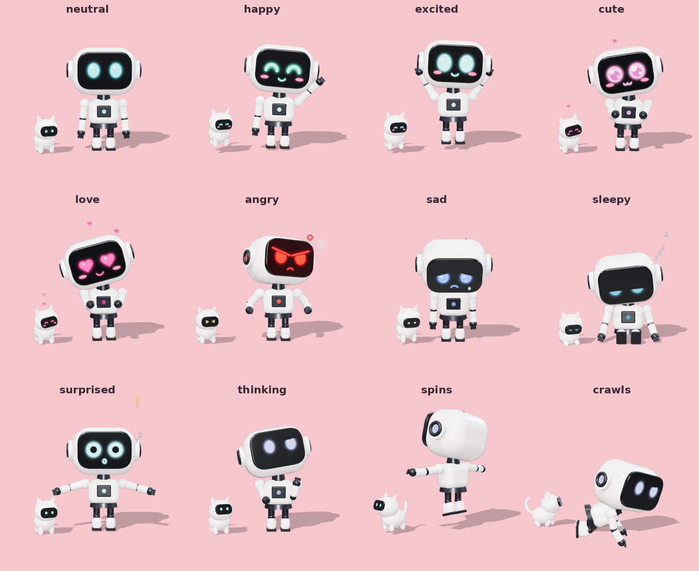
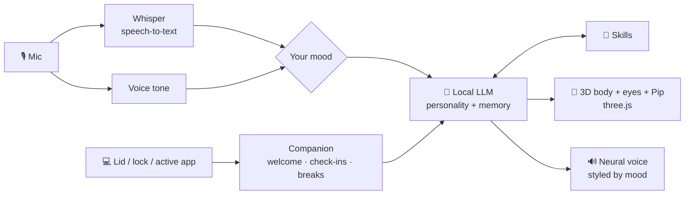
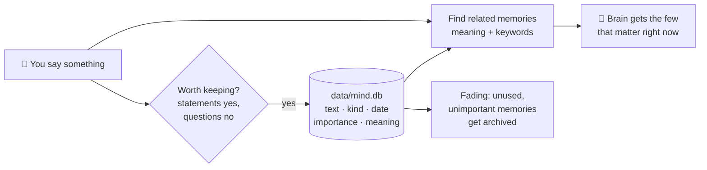

<div align="center">

# ✦ Nova ✦
**A tiny 3D robot who lives on top of your screen, does your work, and feels with you.**



*Nova and her robo-kitty Pip: real-time 3D, always on top of your desktop.*

</div>

---

## What Nova does

- **🤖 Real 3D, on top of everything.** A glossy little robot rendered live in 3D (lighting, reflections, shadows) in a transparent window that floats above all your apps. Drag her anywhere. Her eyes follow your mouse. She **spins, dances, jumps, waves, hugs, walks and crawls** across your screen.
- **👀 Eyes tell everything.** Her visor is a glowing screen. Each mood has its own eyes: `^ ^` happy, sparkly pink cute eyes, beating hearts, **red narrowed angry eyes** with a 💢, droopy sad eyes with a tear, wide surprised rings, sleepy lids...
- **🐱 Has a pet.** **Pip** the robo-kitty hops when you're happy, hides trembling `> <` when Nova is angry, snuggles closer when you're sad, sleeps when Nova sleeps, and follows her when she walks. Click Pip for head pats 💕
- **💗 Feels with you.** She reads your mood from your words **and your voice tone** (loudness, pitch and speed, compared to how *you* normally sound). When you're sad or stressed she softens her voice, comforts you, and does a **cheer-up routine**: wave, spin, dance, crawl over to you, hug. Good news gets a happy spin.
- **🗣️ Talks with a real voice.** A natural neural voice (cute `en-US-AnaNeural` by default) that sounds excited, soft or sleepy to match her mood. If there's no internet, an offline voice takes over. Say **"Hey Nova"** anytime.
- **💻 Opens and closes with you.** Open the lid, unlock or wake the laptop and she's **excited to see you** with a new welcome every time. She remembers your plans ("Your DBMS exam is Friday, ready?"). Close the lid or lock it and she waves **goodbye**.
- **🧑‍💻 Watches over you while you work.** She notices which app you're in and for how long:
  - after 50 minutes non-stop, a break reminder
  - every 90 minutes, a caring check-in question (she then listens for your answer, no wake word needed)
  - a gentle "go to sleep" late at night
  - a playful nudge after too long on YouTube
  - "what did I do today?" answered with a time-per-app summary
- **🧠 Really remembers.** Tell her *"my DBMS exam is on Friday"* and she saves it with the real date, reminds you when you open your laptop, and brings it up when it matters. She finds memories by meaning ("my database test" finds "DBMS exam"), lets unimportant ones fade like real memories, and keeps important, pinned and upcoming ones strong. Plus your conversations, a mood diary and your daily activity. All of it is stored in `data/` on your PC.
- **🛠️ Does the work.** Open and close any app · Google, YouTube, websites · weather · news · Wikipedia · reminders and alarms · notes · find files · volume and media · screenshots · battery/CPU · lock, sleep, shutdown (asks first) · WhatsApp and Gmail (optional, asks first)
- **🔒 Private brain.** Thinking happens on your PC with [Ollama](https://ollama.com). No API keys.
- **⏻ Turn her off anytime.** Use the tray icon or her right-click menu for **Quiet mode** (no check-ins, no wake word), **Hide**, or **Turn off**. Or just say *"Nova, be quiet for an hour."*

## How it works



## Setup (Windows 10/11)

1. **Install Ollama** from https://ollama.com/download, then download Nova's brain:
   ```bash
   ollama pull qwen2.5:7b
   ```
   On a low-end laptop, use `qwen2.5:3b` and change `model` in `settings.toml`.
   For Nova's smart memory search (small, about 270 MB), also run:
   ```bash
   ollama pull nomic-embed-text
   ```
   Without it, Nova still remembers and searches by keywords.
2. **Install Node.js** (LTS) from https://nodejs.org. Nova uses it for her see-through window. The first start sets it up automatically (about a minute).
3. **Install Nova** (Python 3.11 to 3.14. Not 3.15 yet: many packages don't support it):
   ```bash
   git clone https://github.com/HemashreeVI/JarvisAI.git Nova
   cd Nova
   python -m venv venv
   venv\Scripts\activate
   pip install -r requirements.txt
   ```
4. **Edit `settings.toml`**: your name, city, voice, the pet's name, and companion options.
5. **Run**:
   ```bash
   start_nova.bat                 # double-click: picks the right Python for you
   python main.py                 # 3D Nova on your desktop
   python main.py --autostart on  # start Nova every time you log in
   python main.py --no-voice      # typing only
   python main.py --2d            # lightweight 2D body
   python main.py --terminal      # chat in the terminal
   ```
   The first run downloads the speech-recognition model (~150 MB).

## Talking to Nova

| Do this | And Nova... |
|---|---|
| Say **"Hey Nova, ..."** | wakes up and does it |
| **Click** Nova, or press **Ctrl+Alt+N** | listens right away |
| **Double-click** Nova | opens a box to type in |
| **Click Pip** | Pip gets head pats |
| **Right-click** | menu: talk, type, spin, dance, crawl, walk, cheer me up, mute, quit |
| **Drag** | moves her |
| **Tray icon** | show/hide, quiet for 1 hour, turn off |

Try:
- *"Hey Nova, open Spotify"*
- *"what's the weather?"*
- *"remind me to call amma at 7 pm"*
- *"do a dance!"*
- *"I'm so stressed about my exam"*
- *"you're the cutest"*
- *"remember my birthday is March 3rd"*
- *"my DBMS exam is next Friday"*, then later *"when is my exam?"*
- *"what's coming up this week?"*
- *"what did I do today?"*
- *"be quiet for an hour"*

## Optional: WhatsApp and Gmail

- **WhatsApp:** run `pip install pywhatkit`, copy `data/contacts.example.json` to `data/contacts.json`, and fill in the numbers. You need to be logged in to WhatsApp Web.
- **Gmail:** run `pip install google-api-python-client google-auth-oauthlib`. Create an OAuth client (Desktop app) in Google Cloud Console with the Gmail API enabled, and save it as `data/credentials.json`.

Everything in `data/` (memory, mood diary, activity log, contacts, tokens) stays private and is git-ignored.

## Teach Nova a new skill

Drop a file into `nova/skills/`. It's picked up automatically:

```python
from nova.tools import tool

@tool("Flip a coin.")
def flip_coin() -> str:
    import random
    return random.choice(["Heads!", "Tails!"])
```

Use `@tool(..., dangerous=True)` for anything risky. Nova will then ask before running it.

## How Nova's memory works



- **What's saved:** facts (*"I study CSE at VIT"*), likes (*"I love dosa"*), goals (*"I want to learn ML"*), and deadlines with real dates (*"CSE2004 assignment due tomorrow"* is saved with the actual date, so "tomorrow" never goes stale). Course codes become tags.
- **What's skipped:** questions, commands and small talk.
- **Repeats** strengthen a memory instead of creating a copy.
- **Fading:** each memory has a strength from its importance, how often it comes up, and how long since it was last used. Pinned memories and upcoming dates stay strong; passed dates fade within about a week. Faded memories are archived, never silently deleted.
- **Settings:** the `[memory]` section in `settings.toml`.

## Running the tests

```bash
pip install pytest
python -m pytest tests
```

## Project structure

```
main.py              start here
settings.toml        your settings
nova/
  app.py             wires everything together
  brain.py           local LLM + personality + tool use
  emotion.py         reads your mood, decides how Nova reacts
  voice_tone.py      mood from how you sound (learns your normal voice)
  listener.py        mic, "Hey Nova", speech-to-text
  speaker.py         neural voice styled by mood (+ offline backup)
  companion.py       welcome/goodbye, check-ins, breaks, activity log
  presence.py        lid open/close, lock/unlock, sleep/wake, active app (Windows)
  body_electron.py   the see-through always-on-top 3D window (Electron, in shell/)
  body3d.py          fallback 3D window (pywebview)
  body/              three.js: Nova's 3D body, eyes (eyes.js) and Pip
  buddy.py           lightweight 2D body (fallback)
  memory.py          chat history, simple facts and mood diary
  mind/              long-term memory engine: search by meaning, fading, deadlines (data/mind.db)
  tray.py            tray icon (hide / quiet / turn off)
  skills/            everything Nova can do
tests/               automated tests (python -m pytest tests)
data/                private stuff (git-ignored)
```

<div align="center">

💙 Built by [Hemashree VI](https://github.com/HemashreeVI)

</div>
